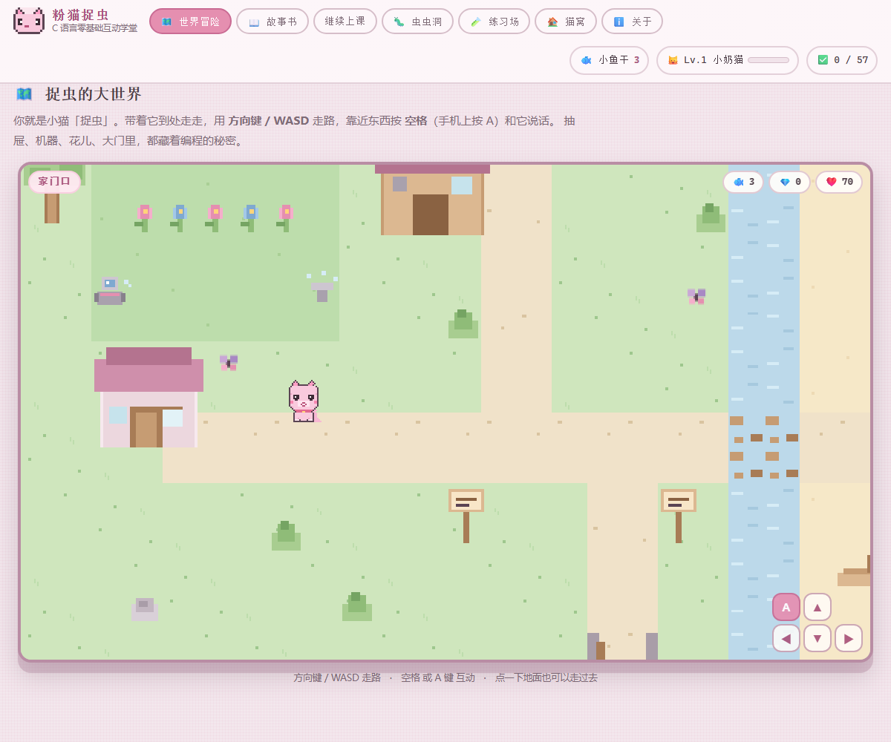
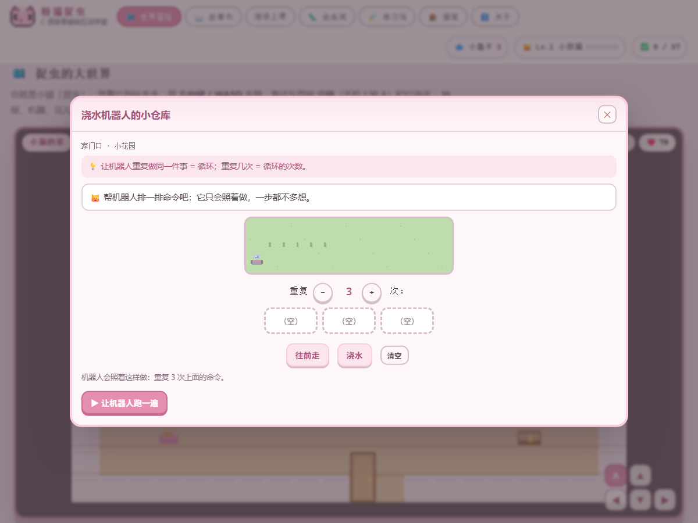
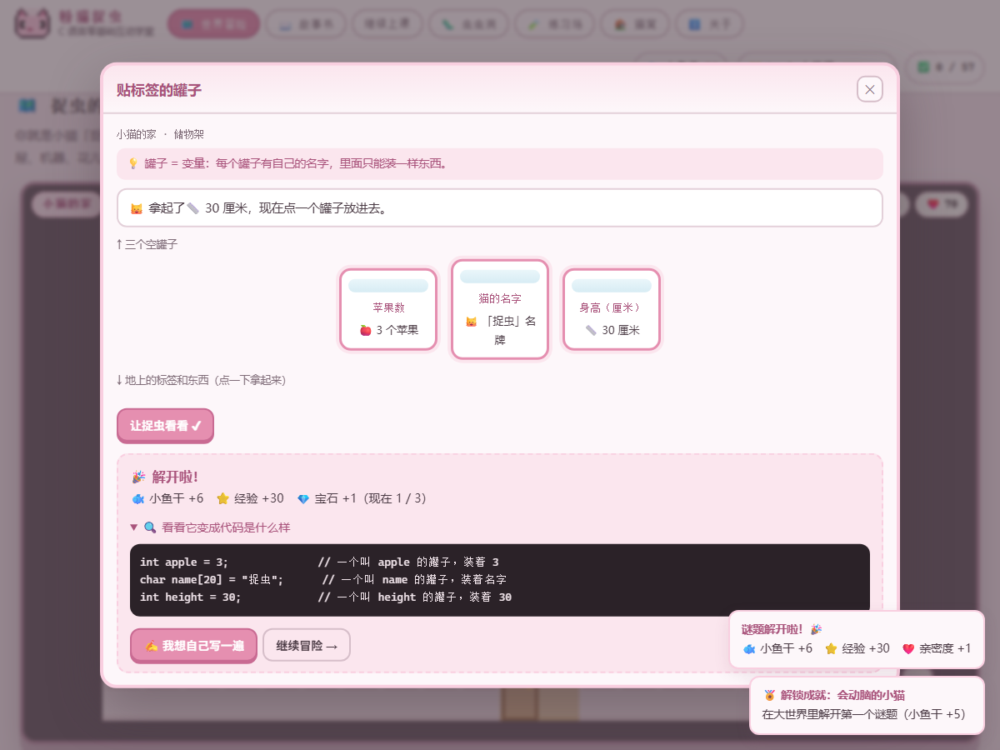
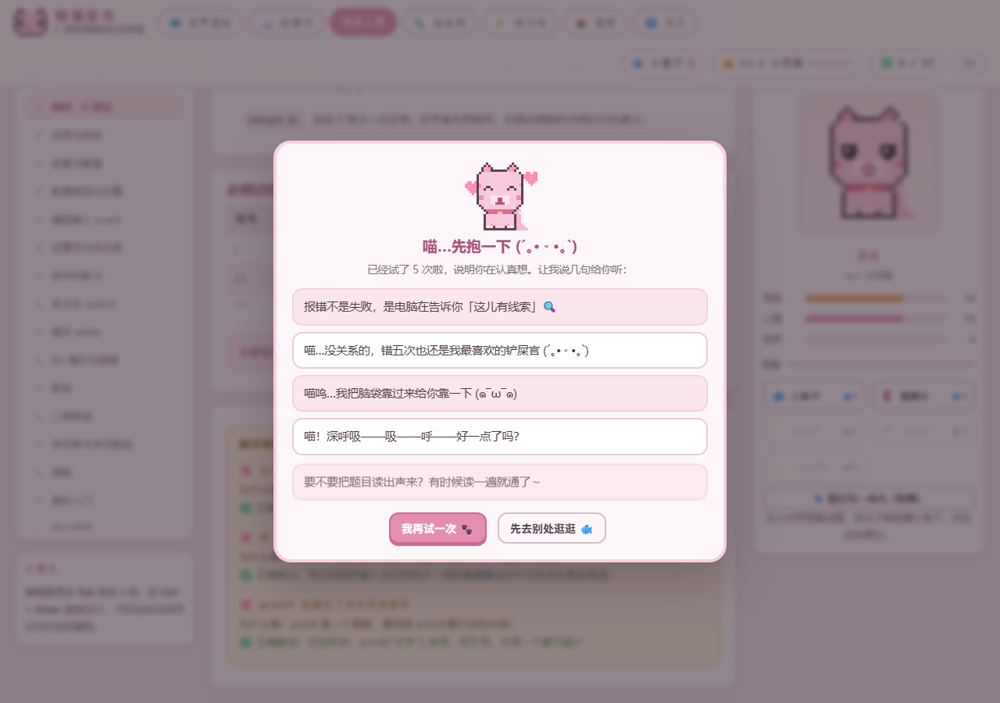
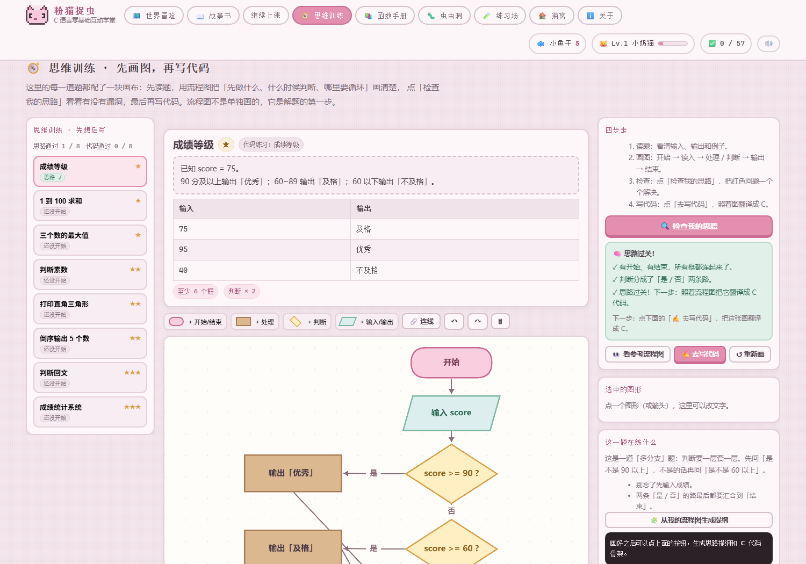
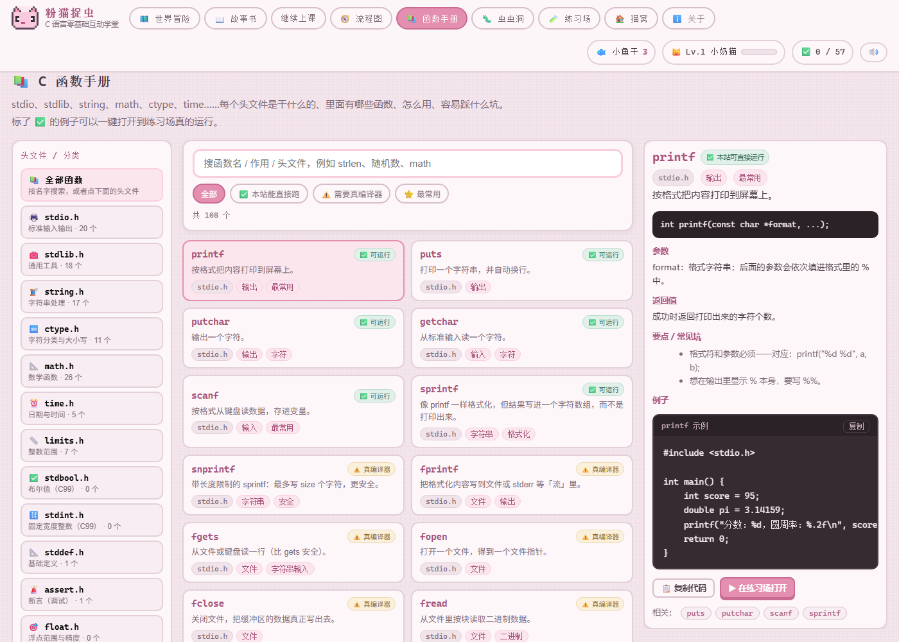
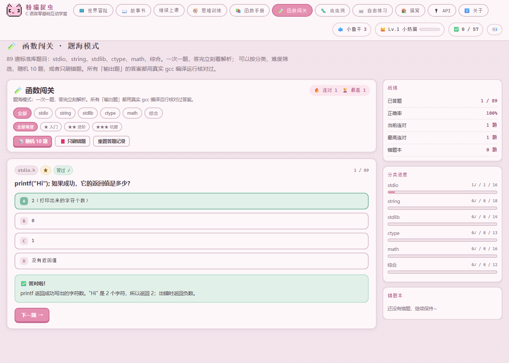
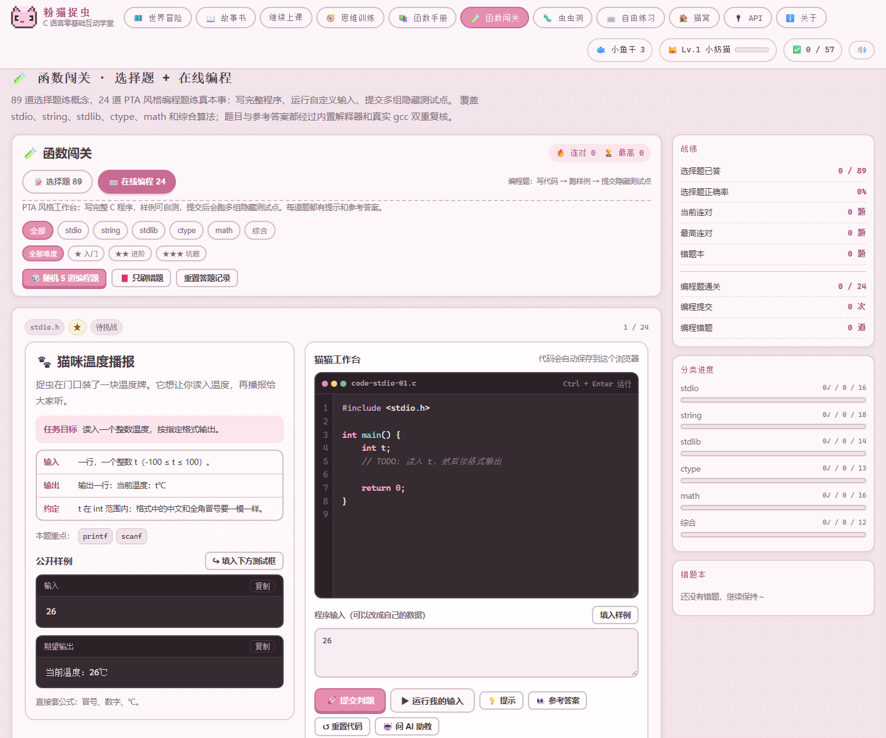

# 🐱 粉猫捉虫 · 用游戏的方式学 C 语言

> 你操控一只粉色像素小猫「捉虫」，在一张可以走动的像素大世界里冒险：打开抽屉、给机器人排命令、把绳子拴到箱子上、让蛋糕机吐出蛋糕、点亮海边灯塔。**解开谜题 → 世界真的会变（花开、门开、桥修好）→ 小猫有饭吃。**

玩明白之后，每个谜题都会告诉你「它变成代码长什么样」，还可以点「我想自己写一遍」，用真正的 C 代码再做一次同样的挑战。







## 🎮 玩法（先把学习忘掉，这是游戏）

| 操作 | 说明 |
| --- | --- |
| 方向键 / WASD | 带着小猫走路；点一下地面也会走过去 |
| 空格 / A 键 | 和身边的东西互动（靠近时会出现提示）；也可以直接点那个东西 |
| Esc | 关掉面板，继续冒险 |

### 世界地图

| 区域 | 里面有什么 |
| --- | --- |
| 小猫的家 | 打个盹、贴标签的罐子、魔法故事书、捉虫的饭碗、捉虫的小背包 |
| 家门口 | 浇水机器人的小仓库、森林大门的门卫、断掉的木桥、点亮灯塔、岸边的小船 |
| 工坊 | 五个抽屉、叮叮当当蛋糕机、箱子、绳子和篮子、抽屉里的抽屉、捉虫的小背包 |
| 森林 | 珠子项链、虫虫洞 |

### 谜题：每个都用「生活里摸得到的东西」讲一件事

| 谜题 | 像什么 | 学到的编程概念 | 解开之后世界会怎样 |
| --- | --- | --- | --- |
| **贴标签的罐子** | 每个罐子有自己的名字，里面只能装一样东西。 | 罐子 = 变量 | 储物架上的三个罐子亮起来 |
| **五个抽屉** | 一排连着的抽屉 = 数组；抽屉的编号 = 下标，从 0 开始数。 | 一排连着的抽屉 = 数组；抽屉的编号 = 下标，从 0 开始数。 | 抽屉柜里的小鱼干归位 |
| **抽屉里的抽屉** | 抽屉里还能有抽屉 = 文件夹里还能有文件夹；一层层打开就是「路径」。 | 抽屉里还能有抽屉 = 文件夹里还能有文件夹；一层层打开就是「路径」。 | 找到钥匙，书桌打开 |
| **叮叮当当蛋糕机** | 进货口是「参数」，出货口是「返回值」，同一台机器换个输入就出不同的东西。 | 机器 = 函数 | 蛋糕机开始发光转动 |
| **浇水机器人的小仓库** | 让机器人重复做同一件事 = 循环；重复几次 = 循环的次数。 | 让机器人重复做同一件事 = 循环；重复几次 = 循环的次数。 | 花园里五朵花全部开放，洒水器喷水 |
| **森林大门的门卫** | 满足就做一件事，不满足就做另一件。 | 「多于 3 个」就是条件表达式 | 森林大门真的打开了（能进森林） |
| **箱子、绳子和篮子** | 拴上就是「指着它」(&)，通过绳子拿或放就是 *p。 | 绳子 = 指针 | 两根绳桩之间的箱子换了个位置 |
| **珠子项链** | 珠子 = 字符，线 = 字符数组，末尾的隐形珠子 \0 = 字符串的结束标记。 | 珠子 = 字符，线 = 字符数组，末尾的隐形珠子 \0 = 字符串的结束标记。 | 串好的珠子挂在小木台上 |
| **点亮灯塔** | 变量、循环、指针。 | 把学过的概念连起来 | 灯塔亮起，海面一片暖光（毕业） |
| **虫虫洞** | 会看报错、会改 bug，是写程序最值钱的本事。 | 会看报错、会改 bug，是写程序最值钱的本事。 | 洞口的虫子一只只被你抓走 |

还有三个小工具：**饭碗**（喂猫）、**小床**（睡一觉）、**小船**（快速旅行）、**背包**（看宝石、成就、进度）。


## 🧩 每个谜题都会「变成代码」

这是这个游戏真正想做的事：玩 → 看到代码 → 自己写。例如「浇水机器人」玩明白后，会看到：

```c
for (int i = 1; i <= 5; i++) {   // 重复 5 次
    往前走();
    浇水();
}
```

点「我想自己写一遍」，就会打开一道对应难度的 C 代码挑战（用自己写的判题器批改，报错全是中文）。这些挑战一共 57 道，全部有参考答案，并且**每道题的参考答案都会自动被测试验证**。


## 🐛 虫虫洞：12 只啃代码的虫子

森林里有个洞，洞里全是把代码咬坏的小虫子。它们让程序报错、算错结果：

| 虫子 | 它干了什么 | 难度 |
| --- | --- | --- |
| 失踪的分号 | 小猫说：程序报错了，它说「缺少分号」。 | ★ |
| 混进来的中文标点 | 这段代码怎么看都正常，但编译器就是不认。 | ★ |
| 小数被打回了原形 | 程序想打印圆周率，却只打印出一个 3。 | ★ |
| 平均分变成了整数 | 三门课总分 241，平均分应该是 80.33，可是程序打印出了 80.00。 | ★★ |
| 一个等号引发的血案 | 程序要判断 x 是不是 0。x 本来就是 0，所以应该输出「x 是 0」。 | ★★ |
| 多跑了一次的循环 | 程序要把 5 个数字打印出来，但它报了一个「数组下标越界」的错。 | ★★ |
| 停不下来的循环 | 程序运行起来就不肯停了（提示「可能是死循环」）。 | ★★ |
| 不肯停下的 switch | 程序想根据数字打印对应的中文数字。输入的数字是 1，本该只打印「一」。 | ★★ |
| 装不下的小盒子 | 程序想存下字符串 "cat!"，但报错说字符串太长了。 | ★★ |
| 白忙一场的交换函数 | 函数里明明交换了，回到 main 里却发现 a 和 b 一点没变。 | ★★★ |
| 被遮住的总和 | 程序本来要算 1+2+3+4+5，结果打印出 0。 | ★★★ |
| 少给了一个值 | 程序想打印「3 + 4 = 7」，可是运行时报错说格式里有个 % 没给值。 | ★ |

## 📖 故事书：想弄懂「为什么」的时候

大世界里的谜题讲「感觉」，故事书讲「原理」。十六课按顺序读，每课都有逐行拆解、常见错误和动手试炼：

| 课 | 主题 | 一句话 | 试炼 |
| --- | --- | --- | --- |
| 第 1 课：你好，C 语言 | 认识程序长什么样，让电脑说出第一句话 | 约 15 分钟 | 4 个 |
| 第 2 课：注释与排版 | 让代码好读、好改、像人写的 | 约 12 分钟 | 3 个 |
| 第 3 课：变量与赋值 | 给数据起名字，装进「盒子」里 | 约 18 分钟 | 3 个 |
| 第 4 课：数据类型与运算 | 整数和小数的区别，藏着很多「坑」 | 约 20 分钟 | 4 个 |
| 第 5 课：键盘输入 scanf | 让程序听你说话：把数据读进来 | 约 18 分钟 | 4 个 |
| 第 6 课：运算符与优先级 | 表达式是怎么算出来的 | 约 20 分钟 | 3 个 |
| 第 7 课：条件判断 if | 让程序会思考、会做选择 | 约 18 分钟 | 3 个 |
| 第 8 课：多分支 switch | 当一个值有很多种情况时 | 约 15 分钟 | 3 个 |
| 第 9 课：循环 while | 重复的事，让电脑去做 | 约 18 分钟 | 4 个 |
| 第 10 课：for 循环与嵌套 | 写循环的标准姿势，顺便画出图形 | 约 20 分钟 | 4 个 |
| 第 11 课：数组 | 一次装很多个数据 | 约 20 分钟 | 4 个 |
| 第 12 课：二维数组 | 表格和矩阵：行与列 | 约 18 分钟 | 3 个 |
| 第 13 课：字符串与字符数组 | 一堆字符排排坐，最后站一个 \0 | 约 20 分钟 | 4 个 |
| 第 14 课：函数 | 把代码打包，用起来更省心 | 约 22 分钟 | 4 个 |
| 第 15 课：指针入门 | 认识「地址」，让函数真正改变外面的变量 | 约 25 分钟 | 3 个 |
| 第 16 课：毕业项目 | 把学到的东西串起来：成绩统计小系统 | 约 30 分钟 | 4 个 |

## 💖 情绪价值（这部分是认真做的）

**每次提交成功** → 撒花 + **几十个夸夸弹窗陆续冒出来铺满整个屏幕**，中心弹出奖励横幅，右下角一个「收下夸夸，继续冒险」按钮可以一键收起（12 秒后也会自己让路）。夸夸池里有 44 句，每次随机抽、用完一轮才会重复。


**连续 5 次没通过** → 小猫会主动来抱你：弹出一个安慰弹窗，**每次给出 5 句互不重复的安慰**（安慰池 24 句，跨弹窗也不会连着重复），带颜文字和「喵」，还会给你一个「💡 给我一点猫猫提示」的按钮——安慰之后重新计数，不打击人。



还有现场合成的音效（不用任何音频文件）：夸夸弹窗的「噗」、通关的小旋律、升级的叮咚、安慰时软软的下行音；顶栏有 🔊/🔇 可以随时关掉。

## 🧭 思维训练：每道题都先画流程图，再写代码

流程图不是单独的画板，而是**每一道题的第一步**。这个板块给了 8 道题，每道题都配着题面、输入输出例子、画布、思路检查和对应的代码练习：

**四步走：读题 → 画图 → 检查 → 写代码**

1. **读题**：题目、输入输出例子、这一题在练什么（判断？循环？数组？），全都摆在画布旁边
2. **画图**：画布一开始只有「开始」，剩下的要你自己画：读入、处理、判断、输出、结束，再用箭头连起来
3. **检查**：点「🔍 检查我的思路」，它会逐条指出结构问题，例如：
   - 缺少「结束」：每条路最后都要走到结束
   - 「输出成绩」后面还没有箭头：流程走到这里就断了
   - 判断只有一条出口：判断应该分成「是」和「否」两条路
   - 判断的两条出口还没标「是 / 否」
   - 这道题需要循环：要有一条箭头绕回上面的判断
   - 好像少了「n」这一步：检查流程里有没有写它
4. **写代码**：点「✍️ 去写代码」，打开这道题对应的 C 代码练习（还是原来的判题器，通过会撒夸夸）

还可以随时点「👀 看参考流程图」对照（参考只是其中一种画法），或点「🧩 从我的流程图生成提纲」把图变成思路提纲 + C 代码骨架。

**8 道题**：成绩等级（多分支）、1~100 求和（循环）、三个数的最大值（连续判断）、判断素数（判断套循环）、打印直角三角形（嵌套循环）、倒序输出 5 个数（数组 + 循环）、判断回文（字符串 + 双指针）、成绩统计系统（综合）。



> 每道题的流程图都会单独保存；思路检查通过会记录下来（思路 ✓），代码练习通过也会记录下来（代码 ✓），左边能看到每道题的进度。
## 📚 C 函数手册：15 个头文件、108 个函数与常量

遇到「这个函数怎么用」时不用去翻零散的教程，这里按头文件分好类，每个条目都写清楚：

- **原型**（长什么样）、**作用**（一句话）、**参数**（每个参数是什么）、**返回值**（返回什么）
- **要点 / 常见坑**（新手最容易错的地方）
- **一段能用的示例代码**

覆盖的头文件：`stdio.h`、`stdlib.h`、`string.h`、`math.h`、`ctype.h`、`time.h`、`limits.h`、`stdbool.h`、`stdint.h`、`stddef.h`、`assert.h`、`float.h`、`errno.h`、`conio.h`，以及 `sizeof`、三目运算符这类「语言本身的小工具」。

- 标 **✅ 本站可直接运行** 的示例，点一下就能打开到练习场真的跑起来（解释器支持 60+ 个常用函数：printf / scanf / sprintf、strlen / strcmp / strncmp / strcpy / strncpy / strcat / strncat / strchr / strstr、sqrt / pow / sin / cos / tan / log / exp / floor / ceil / round / fmin / fmax / hypot、isalpha / isdigit / isspace / toupper / tolower、rand / srand / abs / atoi / atof……）
- 标 **⚠️ 需要真编译器** 的（文件读写、malloc、qsort、结构体相关等）会解释为什么需要真正的 gcc / Dev-C++，并给出示例供你在大编译器里练习
- 还带 **printf / scanf 格式符速查表**、**角度 ↔ 弧度换算表**、**整数范围表**


## 🧪 函数闯关：89 道选择 + 24 道在线编程

函数手册适合「查」，题海适合「练」。这个模块现在分成两个模式，覆盖 `stdio.h`、`string.h`、`stdlib.h`、`ctype.h`、`math.h` 和综合题：

- **选择题 89 道**：概念题（这个函数怎么用/有什么坑）和**输出题**（给你一段完整代码，问输出是什么）
- **在线编程 24 道**：PTA 风格完整工作台，题面 + 输入输出格式 + 公开样例 + 代码编辑器 + 自定义输入 + **4～5 组隐藏测试点**
- **逐点判题**：提交后会显示每个测试点是「通过 / 答案不符 / 运行错误」；失败时会展示期望输出和实际输出，方便自己找差异
- **学习辅助**：每题都有函数标签、分步提示、参考答案和「问 AI 助教」入口
- **游戏化进度**：编程题通关记录、提交次数、编程错题本、撒花夸夸；连着卡住时小猫仍会来安慰
- **难度分级**：★ 入门 / ★★ 进阶 / ★★★ 坑题，可以按分类和难度筛选
- **随机与错题**：选择题可随机 10 题；编程题可随机 5 道，也能只刷错题

> **答案不是手写“看起来对”就算完成。** 41 道选择题输出题由 `tests/drills-gcc.test.mjs` 用真实 `gcc -std=c11` 逐字节校验；24 道编程题的参考答案和全部测试点由 `tests/drills-code.test.mjs` 同时通过**内置解释器**和**真实 gcc** 两套运行器。编写过程中 gcc 抓出过 `isnan` 返回值不可移植、`M_PI` 不是严格标准宏等问题，均已改成标准写法。





## 🔌 API 设置：接上你自己的 AI 助教

网站本身不需要后端；如果你想多一个「会看你的代码的助教」，可以在「API」页填入**你自己的** AI 服务 Key：

- 支持 OpenAI、DeepSeek、智谱 GLM、Moonshot、通义千问、本地 Ollama，以及任意 OpenAI 兼容接口（自定义 Base URL + 模型名）
- 填好后可以：在任务卡点 **「🤖 问 AI 助教」**（结合题目、你的代码和报错给 5 行提示）、在思维训练点 **「🤖 AI 点评我的流程图」**、在函数手册点 **「🤖 让 AI 讲细一点」**
- **Key 只保存在你自己的浏览器 localStorage 里**，本站没有服务器，不会收集；请求直接发给你填写的服务地址
- 公共电脑上用完请点「清除 Key」；Key 可能产生费用，请在自己的服务商后台设置额度


## 🚀 跑起来

三种方式，任选其一：

**1. 双击打开**：直接打开 `index.html` 就能玩（纯静态、零依赖、完全离线）。

**2. 本地服务器**（推荐）：

```bash
npm run serve        # 然后访问 http://localhost:5173
```

**3. 部署到网上**：本站是纯静态站点，把整个文件夹丢给任何静态托管都能跑（GitHub Pages / Gitee Pages / Vercel / Netlify）。仓库自带 GitHub Pages 自动发布配置，详见 [docs/publish.md](docs/publish.md)。


## 🗂 目录结构

```
index.html                       入口（世界 / 故事书 / 猫窝 / 练习场 / 关于）
assets/
  css/style.css                  全部样式（藕粉灰粉 + 游戏界面）
  img/favicon.svg                像素小猫图标
  js/
    interpreter.js               迷你 C 解释器（自己写的词法 / 语法 / 执行 + 中文报错）
    grader.js                    判题器（跑代码、比输出、查结构）
    editor.js                    代码编辑器（行号 + 语法高亮 + 自动缩进）
    world-art.js                 世界像素素材（地形 + 房子 / 抽屉柜 / 机器人 / 蛋糕机 / 灯塔…）
    world-data.js                四张地图（家里 / 家门口 / 工坊 / 森林）+ 物件摆放
    world.js                     世界引擎（走路、碰撞、相机、交互提示、特效）
    puzzles.js                   谜题一：罐子 / 抽屉 / 抽屉迷宫 / 蛋糕机 / 浇水机器人
    puzzles-b.js                 谜题二：门卫 / 绳子 / 珠子 / 灯塔 / 虫虫洞 + 饭碗小床背包
    pet-art.js                   像素猫画稿（全部用代码画出来）
    pet.js                       猫猫动画（眨眼、吃东西、升级特效）
    store.js                     存档（小鱼干 / 等级 / 宝石 / 世界旗标 / 成就）
    app.js                       游戏状态（解谜奖励、喂猫、成就）
    content-lessons-1~4.js       十六课故事书内容
    content-bugs.js              十二只虫子的关卡
    content-funcs-1~4.js          C 函数手册的 108 个条目（stdio/stdlib/string/math/ctype/time…）
    flowchart.js                 流程图引擎（画布、拖拽、连线、参考图渲染）
    content-think.js             8 道思维训练题（题面 / 例子 / 参考流程图 / 对应代码练习）
    views-think.js               思维训练界面（题目列表 / 画布 / 思路检查 / 参考图 / 写代码）
    views-funcs.js               函数手册界面（搜索 / 筛选 / 详情 / 打开示例）
    content-drills-1~3.js         89 道函数选择题（stdio/string/stdlib/ctype/math/综合）
    content-drills-code.js        24 道 PTA 风格在线编程题（题面 / 样例 / 测试点 / 答案）
    views-drills.js              函数闯关选择题界面（题海 / 错题本 / 连对）
    views-drills-code.js         PTA 风格编程工作台（编辑器 / 自定义输入 / 隐藏测试点）
    ai.js                        AI 客户端（OpenAI 兼容接口 / 预设 / Key 本地保存）
    views-api.js                 API 设置页 + AI 助手弹窗
```


## 🛠 开发与自检

不需要安装任何依赖（Node 18+ 即可）：

```bash
npm test             # 解释器单元测试 + 课程/世界内容校验（参考答案必须真的能通过判题）
npm run e2e          # 浏览器里模拟学生做题（判题 → 奖励 → 喂猫）
npm run e2e:world    # 浏览器里把大世界玩一遍（走路、开门、解 7 个谜题、看世界有没有变化）
npm run e2e:tools    # 浏览器里验证思维训练 + 函数手册（题目、思路检查、搜索、一键运行）
npm run e2e:api      # 浏览器里验证 API、选择题、在线编程、自定义输入、隐藏测试点和错题本
npm run serve        # 本地预览
npm run art:world    # 把世界像素素材渲染成 PNG，改画稿时肉眼看效果
```

`npm test` 会验证这些事：解释器行为、每道题参考答案能否通过、每张地图是否规整、出生点是否站在能走的地方、每个谜题有没有配对应的代码挑战，以及**用真实 gcc 编译运行 41 道函数输出题、并核对 24 道在线编程题的全部测试点**（需要本机有 gcc）。


## ❓ 常见问题

**玩到一半关掉网页，进度会丢吗？**

不会。小鱼干、宝石、解开的谜题、世界状态（花开了、桥修好了）都存在浏览器的 `localStorage` 里。

**为什么多打一个空行也会判错？**

因为输出是**按行严格比较**的：行数、顺序、每一行内容都要对。多打的空行不会被「自动修正」，判题会直接列出「题目要的输出 / 你的输出」的逐行对比，告诉你第几行多了空行。这是新手最容易养成的坏习惯（printf(\"第一行\\\\n\\\\n\") 会多出一行空白），所以我们宁可严格一点，也不让它在真正的判题网站上栽跟头。只有每行行尾多余的空格会被忽略。

**为什么谜题和代码是分开的？**

先用手玩明白「概念」，再看「它写成代码是什么样」，最后自己写一遍——比一上来就抄代码更容易真正学会。当然你也可以直接跳到代码挑战。

**小猫会不会饿死？**

不会。饱食度和心情最低降到 0，它只会「更想你一点」，不会生病、不会离开。

**能离线玩吗？**

能。整个站点没有任何外部请求（没有 CDN、没有字体、没有图片素材，像素画全是代码画的）。


## 🙏 署名与开源许可

- 本项目采用 **MIT 许可**，可自由学习、修改、再发布，请保留原作者署名。

- 详细的参考与致谢（含参考过的开源项目与教学资料）见 [CREDITS.md](CREDITS.md)。

- 二次开发时如果加入了别人的代码、图片、字体或课程内容，**请在 `CREDITS.md` 里补充署名**。


## ⚠️ 免责声明

这是一个教学游戏，内置的是**教学用的迷你 C 解释器**（不是完整编译器）。为了让错误提示对初学者友好，它会在数组越界、空指针、死循环等真实 C 语言里「行为不确定」的地方主动报错。学完基础后请尽快过渡到 gcc / clang 等真实工具链。


---


祝你玩得开心，也希望捉虫能吃饱饱 🐟
